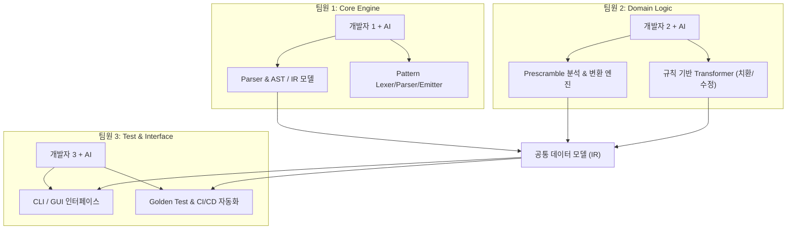
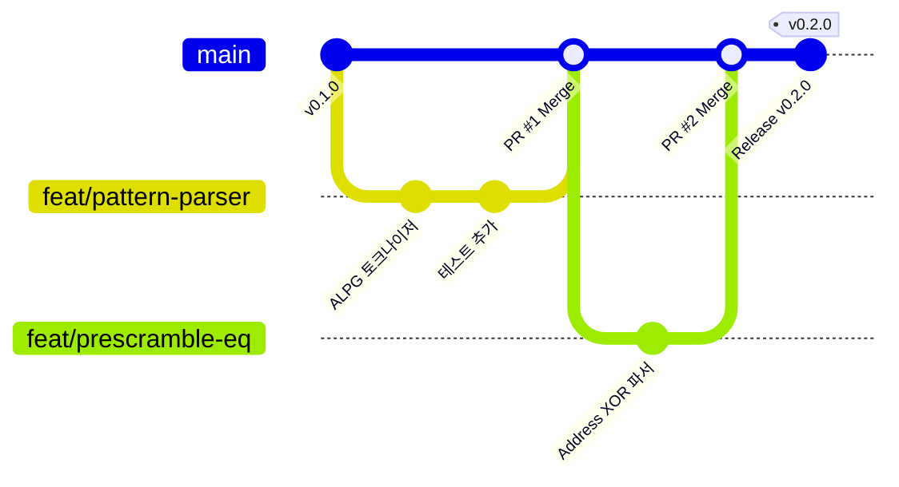
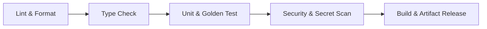

# T5833 Pattern & Prescramble 변환 프로그램 개발 및 CI/CD 전략

본 문서는 **Advantest T5833 Memory Tester**의 Pattern 및 Prescramble 프로그램 수정/변환 도구(`ATL_Converter`)를 3인의 개발자가 각자의 **AI 코딩 에이전트**와 함께 협업 개발하기 위한 개발 프로세스, Git 브랜치 전략, 코드 품질 관리 및 CI/CD 전략을 정의합니다.

---

## 1. 프로젝트 개요 및 협업 구조

### 1.1 팀 구성 및 R&R (역할 분담 제안)
3명이 각자 AI 에이전트를 페어 프로그래머로 활용할 때, 모듈 간 결합도를 낮추고 인터페이스를 조기에 확정하는 것이 핵심입니다.

- **개발자 1 (Core Engine & Pattern Parser)**
  - T5833 ALPG Pattern 문법 파싱 및 중간 표현(AST/IR) 설계
  - Pattern 벡터, 명령어, 타이밍 세트 재구성 및 Emitter(코드 생성기) 개발
- **개발자 2 (Prescramble Engine & Transformation Rule)**
  - 논리/물리 어드레스 및 DQ 매핑 수식/테이블 파서 및 변환기
  - 패턴과 스크램블 간 연동 룰 엔진(Pin Swap, Address Inversion 등) 개발
- **개발자 3 (CLI/UI & Validation/CI-CD 파이프라인)**
  - CLI 명령어 인터페이스 및 검증 툴 개발
  - Golden Sample 기반 회귀 테스트(Regression Test) 구축, CI/CD 파이프라인 유지보수

---

## 2. AI 에이전트 페어 프로그래밍 원칙

AI 에이전트를 적극 활용하는 프로젝트에서는 **"생산 속도는 비약적으로 증가하지만, 환각(Hallucination) 및 도메인 제약 위반 위험"**이 상존합니다. 이를 방지하기 위한 팀 수칙을 설정합니다.

### 2.1 3대 개발 수칙
1. **Spec-First (명세 우선 개발)**:
   - 코드를 생성하기 전, 모듈의 입력/출력 인터페이스(Type Hint, Pydantic 모델 등)와 [T5833_AGENT_GUIDE.md](file:///c:/python/ATL_Converter/docs/T5833_AGENT_GUIDE.md)를 에이전트 컨텍스트에 주입합니다.
2. **Test-Driven with Golden Samples (골든 샘플 기반 TDD)**:
   - 실제 T5833 테스터의 정상 동작 패턴/스크램블 파일 조각(Golden Sample)을 테스트 케이스로 확보하고, 변환 전/후 기대 결과를 명시한 단위/통합 테스트를 먼저 작성합니다.
3. **인간 리뷰어의 최종 책임 (Human-in-the-Loop)**:
   - AI 에이전트가 작성한 코드는 테스터 문법(ALPG 주기, Rate, TS, DVS 등)을 임의로 생략하거나 왜곡할 수 있으므로, 반드시 도메인 규칙 체크리스트를 기반으로 상호 리뷰를 거칩니다.

---

## 3. Git 브랜치 전략 (Trunk-based Development 기반)

AI를 사용하면 브랜치 수명이 길어질수록 대규모 충돌(Merge Conflict)이 발생하기 쉽습니다. 따라서 **짧은 수명의 피처 브랜치(Short-lived Feature Branch)**와 **빈번한 병합**을 지향하는 GitHub-Flow 기반 전략을 채택합니다.

### 3.1 브랜치 명명 규칙
- `main`: 언제나 배포 및 테스트 가능한 안정 상태 유지 (보호 브랜치 설정: 직접 Push 금지, PR 필수)
- `feat/<기능명>`: 새 기능 개발 (예: `feat/alpg-vector-parser`, `feat/scramble-pin-swap`)
- `fix/<버그명>`: 버그 수정 (예: `fix/ts-index-out-of-range`)
- `test/<테스트명>`: 테스트 케이스 및 골든 샘플 추가
- `docs/<문서명>`: 가이드 문서 업데이트

### 3.2 PR (Pull Request) 규칙
- **작은 단위 PR**: 1회 PR당 300라인 이내 권장 (AI 코드가 방대해지는 것을 방지)
- **AI 사용 표기**: PR 템플릿에 AI가 생성한 부분과 수동 검증한 항목을 명시
- **최소 승인 인원**: 3인 팀이므로 본인 외 **최소 1인의 승인(Approval)** 필수
- **CI 통과 필수**: Lint, Type Check, Test 전체 통과 시에만 Merge 가능

---

## 4. 사내 Git 서버 기반 CI/CD 파이프라인 전략

사내 Git(GitLab, Gitea, GitHub Enterprise 등) 환경에서 자동화 파이프라인을 구축합니다.

### 4.1 파이프라인 스테이지 구성

1. **Stage 1: Lint & Code Style Check**
   - 도구: `ruff check .`, `ruff format --check .`
   - 목적: AI마다 생성하는 코드 스타일(따옴표, 들여쓰기, 임포트 순서) 통일
2. **Stage 2: Static Type Check**
   - 도구: `mypy src/`
   - 목적: T5833 데이터 모델(Vector, Rate, Instruction 등)의 타입 안정성 보장
3. **Stage 3: Automated Testing & Coverage**
   - 도구: `pytest --cov=src --cov-report=xml --cov-fail-under=80`
   - 내용:
     - 단위 테스트 (파서, 변환 로직 함수)
     - Golden Test (실제 T5833 패턴 변환 전/후 diff 검증)
4. **Stage 4: Domain Rule Validation (T5833 전용 린트)**
   - 스크립트: 테스터 문법 위반(존재하지 않는 TS 호출, Pin count 불일치, Prescramble 순환 참조) 자체 검사
5. **Stage 5: Packaging & Release (태그 푸시 시)**
   - `uv build` 또는 `pyinstaller`를 통한 사내 배포용 단일 실행 파일(`.exe`) 패키징
   - 사내 Git Release 아티팩트 자동 등록

---

## 5. 단계별 개발 마일스톤

| 단계 | 기간 | 주요 목표 | 검증 기준 |
| :--- | :--- | :--- | :--- |
| **Phase 1** | 1~2주차 | • 사내 Git & CI 환경 구축 • T5833 Pattern/Scramble 공통 데이터 모델(IR) 정의 • 골든 샘플 데이터셋 확보 | • 파이프라인 녹색 통과 • 샘플 파싱 AST 생성 성공 |
| **Phase 2** | 3~4주차 | • Pattern 파서 및 수정 Emitter 구현 • Prescramble 파서 및 수식/테이블 변환기 구현 | • 단위 테스트 커버리지 > 80% • 무변환 파싱->재출력 시 원본 일치(Idempotency) |
| **Phase 3** | 5~6주차 | • Pattern + Prescramble 통합 변환 룰 엔진 개발 • CLI 인터페이스 구현 (일괄 변환 기능) | • 통합 골든 테스트 통과 • 실제 테스트 설비 오프라인 문법 검사기 통과 |
| **Phase 4** | 7주차 | • GUI or 확장 기능 추가 • 현업 엔지니어 PoC 피드백 및 릴리즈 (v1.0.0) | • 사내 테스터 엔지니어 검증 완료 |
