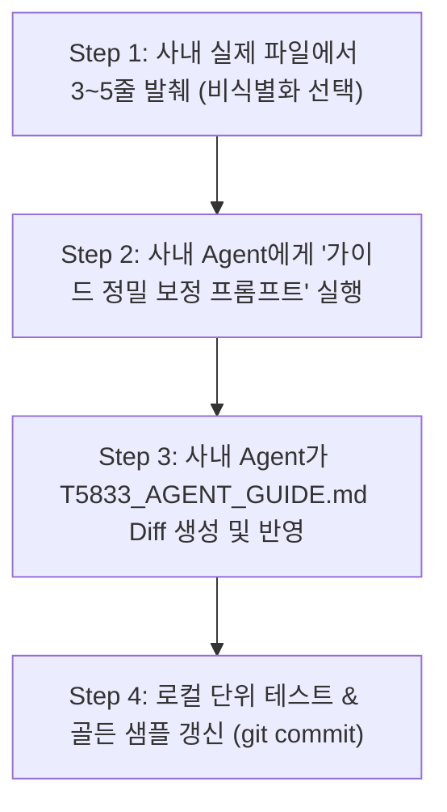

# 사내 AI Agent를 활용한 도메인 가이드 튜닝 및 보안 가이드라인

본 문서는 사내 보안 규정상 **실제 Pattern 및 Prescramble 원본 파일을 외부로 유출할 수 없는 환경**에서, **사내 보안 인가된 AI Agent**를 활용하여 [T5833_AGENT_GUIDE.md](file:///c:/python/ATL_Converter/docs/T5833_AGENT_GUIDE.md)를 실제 사내 환경 문법에 100% 맞게 정밀 보정(Fine-Tuning)하는 절차와 프롬프트 템플릿을 제공합니다.

---

## 1. 사내 Agent 튜닝 3단계 워크플로우



1. **Step 1: 실제 파일 대표 조각 발췌 (In-House Sample Snippet)**
   - 패턴 파일 헤더 5줄, 벡터 바디 5줄, SDEF 5줄, Prescramble 수식 5줄을 발췌합니다.
   - 제품명, 칩 내부 핵심 알고리즘 수식이 민감한 경우, 제공된 [sanitize_sample.py](file:///c:/python/ATL_Converter/scripts/sanitize_sample.py) 스크립트를 실행하여 값만 더미로 마스킹합니다.
2. **Step 2: 사내 Agent에게 튜닝 프롬프트 주입**
   - 아래 2장의 **[사내 Agent 전용 지시 프롬프트]**를 복사하여 사내 AI Agent에게 전달합니다.
3. **Step 3: 가이드 및 모델 자동 업데이트**
   - 사내 Agent가 실제 문법의 차이점(구분자, 키워드, Way 포맷, Prescramble 문법)을 파악하고 `T5833_AGENT_GUIDE.md`의 `## 7. 사내 실제 T5833 문법 세부 정의` 섹션을 자동으로 채우게 합니다.

---

## 2. 사내 Agent에게 전달할 복사/붙여넣기용 프롬프트 템플릿

사내 AI 에이전트(Cursor, Copilot Workspace, 사내 로컬 LLM 등)와 대화할 때 아래 프롬프트를 그대로 복사하여 실행하십시오.

````markdown
### [사내 Agent 지시 프롬프트]

**[역할 정의]**
너는 Advantest T5833 Memory Tester 전문 컴파일러 엔지니어이자 본 프로젝트(`ATL_Converter`)의 시니어 개발자다.

**[배경]**
현재 `docs/T5833_AGENT_GUIDE.md`에는 T5833의 일반적인 표준 문법(1-way, 2-way, 4-way, SDEF, Prescramble)이 정리되어 있다.
하지만 우리 사내에서 실제 사용하는 Pattern 및 Prescramble 프로그램은 사내 고유의 포맷팅 규칙과 차이점이 있다.

**[작업 목표]**
내가 아래에 제공하는 실제 파일의 샘플 조각(Header, Vector, SDEF, Scramble)을 정밀 분석하여:
1. `docs/T5833_AGENT_GUIDE.md` 파일의 `## 7. 사내 실제 T5833 문법 세부 정의 (In-House Specifics)` 섹션을 실제 문법에 맞게 업데이트하라.
2. 기존 파서/모델(`src/atl_converter/models.py`, `src/atl_converter/pattern_parser.py`, `src/atl_converter/scramble_engine.py`)에서 수정되어야 할 부분을 식별하고 코드를 업데이트하라.
3. Few-shot 예제 중 실제 사내 문법과 다른 점을 사내 형식에 맞게 교체하라.

---

**[사내 실제 파일 샘플 입력]**

### 1) 실제 Pattern 파일 샘플:
```text
(여기에 사내 Pattern 파일의 상단 헤더 5줄과 실제 벡터 5~10줄을 붙여넣으세요)
```

### 2) 실제 SDEF 파일 샘플:
```text
(여기에 사내 SDEF 파일의 핵심 블록 10줄 내외를 붙여넣으세요)
```

### 3) 실제 Prescramble 파일 샘플:
```text
(여기에 사내 Prescramble 수식 또는 테이블 파일 10줄 내외를 붙여넣으세요)
```

---

**[출력 요구사항]**
- 문법 분석 결과 보고 (기존 가이드와의 차이점 3가지 이상 명시)
- `docs/T5833_AGENT_GUIDE.md` 수정 파일
- 필요한 소스 코드 수정 사항 및 `tests/fixtures/` 골든 샘플 갱신
````

---

## 3. 문법 분석 시 점검해야 할 핵심 체크리스트 (사내 개발자 확인용)

사내 Agent가 분석할 때 누락하기 쉬운 포인트들이며, 프롬프트 실행 후 결과를 검토할 때 사용합니다:

### 3.1 Pattern & Way 구분자 체크포인트
- [ ] **구분자(Delimiter)**: 핀 데이터 토큰 구분이 공백(Space)인가, 탭(Tab)인가, 컬럼 고정폭(Fixed Column Width)인가?
- [ ] **Way 표기법**:
  - 4-way의 경우 핀당 4비트 연속인가(예: `1010`), 아니면 4개의 서브 사이클 라인인가?
  - DQS나 CLK 같은 차동 신호(Differential Pin)의 핀 벡터 표현(예: `C`, `1/0`, `P/N`)이 어떻게 기술되어 있는가?
- [ ] **헤더 선언 키워드**:
  - 핀 리스트 선언이 `PIN_ASSIGN:`인가, `PIN_LIST:`인가, 아니면 SDEF 내부에서만 선언되는가?
  - 패턴 종료 지시어가 `STOP`인가, `HALT`인가, `END_PATTERN`인가?

### 3.2 SDEF 체크포인트
- [ ] **포맷 키워드**: SDEF 블록이 `SDEF "이름" { ... }` 구조인가, 아니면 Advantest SOC 문법(`.soc`)인가?
- [ ] **Way 바인딩**: 2-way / 4-way 인터리브 채널 할당이 `WAY_ASSIGN` 키워드인가, 또는 핀 포맷(`NRZ_4W`, `DNRZ_2W` 등) 속성으로 지정되는가?

### 3.3 Prescramble 체크포인트
- [ ] **수식 vs 테이블**:
  - 논리-물리 주소 변환이 불리언 수식(Boolean Expression: `^`, `&`, `|`) 형태인가?
  - 비트 매핑 테이블(Mapping Table: `0 -> 3`, `1 -> 2` 등) 형태인가?
  - C언어 매크로 함수(`SCRAMBLE_FUNC(...)`) 형태인가?
- [ ] **어드레스 축 명칭**:
  - `X`, `Y`인가, `ROW`, `COL`인가, `AX`, `AY`인가?
  - 뱅크(Bank) 주소 스크램블(`BA0`, `BG0`)도 함께 포함되어 있는가?

---

## 4. 민감 정보 마스킹 스크립트 안내

사내 Agent에게조차 특정 제품명이나 민감한 칩 주소 수식을 그대로 노출하기 꺼려지는 경우, 본 프로젝트에 동봉된 [sanitize_sample.py](file:///c:/python/ATL_Converter/scripts/sanitize_sample.py)를 사용할 수 있습니다.

```bash
# 패턴 파일의 신호명 및 레이블을 마스킹하고 문법 구조만 남겨서 sample_sanitized.pat 로 출력
uv run python scripts/sanitize_sample.py tests/fixtures/sample_pattern.pat sample_sanitized.pat
```
이 도구는 토큰의 길이, 키워드 구조, Way 비트 폭은 100% 보존하면서 식별자만 안전하게 치환합니다.
