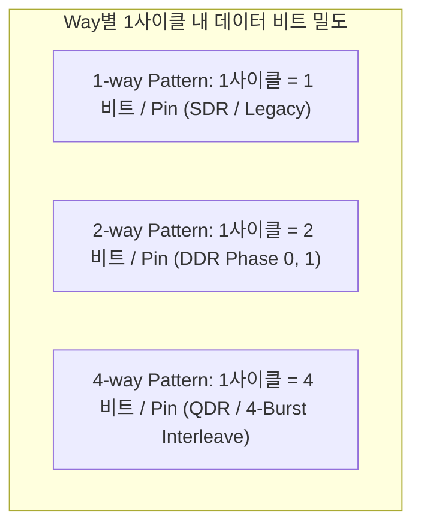

# Advantest T5833 Pattern & Prescramble 엔지니어링 가이드 (AI Agent Context)

> **[시스템 안내]**  
> 본 문서는 **Advantest T5833 Memory Tester** 전용 Pattern 및 Prescramble 프로그램을 파싱, 변환, 생성하는 코드 어시스턴트(AI Agent)를 위한 도메인 지식 베이스 및 기능 정의서입니다.  
> T5833 관련 코드를 작성하거나 수정할 때는 반드시 본 가이드의 **Multi-way(1-way, 2-way, 4-way) 구분**, **SDEF 연동 규칙**, **기능 요구사항(FR-1~9)**, **Few-shot 예제** 및 **도메인 제약사항**을 준수해야 합니다.

---

## 1. T5833 도메인 개요

### 1.1 Advantest T5833 테스터의 특성
- **용도**: DRAM, LPDDR4/4X/5, HBM, Flash 등 초고속 메모리 반도체 웨이퍼(Wafer) 및 패키지(Package) 양산/테스트 설비.
- **핵심 컴포넌트**:
  - **ALPG (Algorithmic Pattern Generator)**: 고속으로 메모리 주소(X, Y, Bank) 및 데이터(Data)를 실시간 연산 생성하는 하드웨어 엔진.
  - **Timing Set (TS / Rate)**: 각 사이클별 펄스 폭, 지연 시간, 주기를 정의하는 타이밍 세트.
  - **Pin Format**: 테스터 채널(Pin)별 드라이브(Drive: NRZ, RZ, RO, DNRZ 등) 및 콤페어(Compare: EDGE, WINDOW) 파형 정의.
  - **SDEF (Signal Definition)**: 테스터 물리 채널과 논리적 디바이스 신호명을 바인딩하고 핀 그룹 및 Way 인터리브 구성을 정의하는 파일.

### 1.2 Pattern과 Prescramble의 관계
1. **Pattern (ALPG Pattern)**:
   - 테스터 하드웨어가 매 사이클마다 메모리 핀에 인가할 신호(0, 1, L, H, X, Z 등)와 ALPG 명령어(INCX, INCY, LOOP 등)의 순차 집합.
2. **Prescramble (프리스크램블)**:
   - 반도체 칩 내부의 **물리적 셀 배치(Physical Layout)**와 외부 **논리적 핀/주소(Logical Address/Data)**는 배선 최적화나 설계 구조상 1:1로 일치하지 않습니다.
   - 테스터가 메모리 내부 셀에 실제 원하는 데이터 패턴(Solid, Checkerboard, Stripe 등)을 쓰기 위해, **논리 주소/데이터를 물리 주소/데이터로 사전에 꼬아주는(Scramble/XOR 연산) 전처리 프로그램 및 매핑 테이블**입니다.

---

## 2. T5833 Pattern 문법 및 구조 상세

### 2.1 어휘 및 구문 규칙 (Lexical & Grammar Specifications)

AI Agent는 T5833 Pattern 파싱 및 코드 생성 시 프로그래밍 언어(C/Java)와의 차이점을 명확히 인지해야 합니다:

#### 1) 주석(Comment) 기호 규칙:
- **`;` (세미콜론) — 핵심 라인 주석 기호**:
  - **[매우 중요]** C 언어와 달리, T5833 Pattern 및 Prescramble에서 `;`는 **명령문 종료자가 아니라 "라인 주석(Line Comment)의 시작 기호"**입니다.
  - 한 라인에서 `;`가 나타나면, 그 위치부터 해당 라인 끝까지의 모든 텍스트는 **주석(Comment)**으로 처리되며 파싱 대상에서 제외되어야 합니다.
  - 예: `TS1  INCX  1010  ; 이것은 주석입니다` ➔ 벡터 데이터는 `1010`이며, `;` 이후는 전부 주석입니다.
- **`!` (느낌표)**:
  - 파일 헤더, 섹션 구분 블록, 인라인 주석으로 빈번히 사용되는 주석 기호입니다.
  - 예: `! ====================`, `WAY_MODE: 4 ; ! 4-way mode`
- **`*` (별표)**:
  - **라인의 1번째 열(Column 0)**에 `*`가 오면 해당 라인 전체는 코멘트로 취급됩니다.
- **`//` (더블 슬래시)**:
  - C-프리프로세서 매크로나 최신 스크립트 결합 시 지원되는 한 줄 주석입니다.

#### 2) 문장 종결자(Statement Terminator) 및 개행:
- 각 벡터 라인은 세미콜론이 아니라 **개행 문자 (`\r\n` 또는 `\n`)**에 의해 구분되고 종결됩니다.
- 라인 끝에 세미콜론이 없는 경우도 완전히 유효한 문법입니다:
  ```text
  START:      TS1  INCX  1010           ! 세미콜론 없이 주석만 있는 경우 (유효)
              TS1  NOP   0000 ; 주석    ! 세미콜론 주석이 있는 경우 (유효)
  ```

#### 3) 공백 및 토큰 구분자 (Whitespace & Delimiters):
- 라벨, TS, ALPG 명령어, 핀 벡터 데이터 간의 구분은 **1개 이상의 공백(Space) 또는 탭(Tab)**으로 이루어집니다.
- 고정 컬럼 폭(Fixed-column format)과 가변 공백(Free format)을 모두 수용할 수 있어야 합니다.

#### 4) 라벨(Label) 규칙:
- 영문자, 숫자, 언더스코어 조합 `[A-Za-z0-9_]+:` 형태 (콜론 포함).
- 라벨 단독으로 한 라인을 차지할 수도 있고, 벡터 명령어와 동일한 라인에 위치할 수도 있습니다.

#### 5) 진법 및 수치 표현 (Literals & Radix):
- 10진수: `256`, `LOOP(16)`
- 16진수: `0x1F`, `H'1F`, `X'1F'`
- 2진수: `0b1010`, `B'1010'`

---

### 2.2 파일 구조 개요
T5833 Pattern 파일은 일반적으로 **헤더(Header / SDEF 바인딩 / Pin List / Way 선언)**와 **패턴 바디(Pattern Vector Body)**로 구성됩니다.

```text
!===================================================================
! T5833 ORIGINAL PATTERN FILE EXAMPLE (WITH SDEF & WAY DECLARATION)
!===================================================================
PATT_NAME: PAT_DRAM_BURST_TEST ;
SDEF_USE: "lpddr4_pkg.sdef" ;          ! SDEF 정의 파일 참조
WAY_MODE: 4 ;                          ! 4-way Interleave 패턴 선언
PIN_ASSIGN: CLK, CS_N, CA[0:5], DQ[0:7] ;

; Rate / Timing Set References: TS1(Write), TS2(Read)
;-------------------------------------------------------------------
; LABEL      TS   ALPG_INSTRUCTION      PIN_VECTOR_DATA (4-WAY)   COMMENT
;-------------------------------------------------------------------
START:
             TS1  SETX(0), SETY(0)      1010 0000 00000000 DDDDDDDD ; ACT + WR 사이클
             TS1  NOP                   1010 1111 11111111 ZZZZZZZZ ; NOP 대기
             TS1  INCX                  1010 0000 00000000 DDDDDDDD ; WR Burst 사이클
             TS2  NOP                   1010 0101 00000000 HHHHLLLL ; RD Burst 사이클
END_PAT:     TS1  STOP                  0000 1111 11111111 ZZZZZZZZ ; 패턴 종료
```


---

### 2.2 Multi-way (1-way, 2-way, 4-way) Pattern 구분 및 형태적 차이

T5833은 테스터 내부 클럭 주기(Rate Period) 대비 디바이스 핀의 고속 전송률(Data Rate)을 맞추기 위해 **멀티웨이(Multi-way / Interleave)** 아키텍처를 지원합니다. **1-way, 2-way, 4-way는 벡터 데이터 표기법과 ALPG 사이클 동작이 완전히 다르므로 반드시 구분해야 합니다.**



| 구분 | 1-way (Single-way) | 2-way (Dual-way) | 4-way (Quad-way) |
| :--- | :--- | :--- | :--- |
| **적용 영역** | 저속 제어 신호, DC 테스트, 레거시 SDRAM | DDR2/3/4 커맨드/클럭, 중간 속도 DRAM | LPDDR4/5, GDDR6, 고속 버스트(Burst 4/8/16) |
| **사이클당 비트 수** | 핀당 **1 비트** (예: `1`, `0`, `D`) | 핀당 **2 비트** (Phase 0, 1) | 핀당 **4 비트** (Phase 0, 1, 2, 3) |
| **표기 형태 A<br>(Compact형)** | `CLK CS DQ`<br>`1   0  D` | `CLK CS DQ`<br>`10  00 DD` | `CLK  CS   DQ`<br>`1010 0000 DDDD` |
| **표기 형태 B<br>(Phase 분리형)** | `1 0 D` | `[PH0] 1 0 D  [PH1] 0 0 D` | `[P0] 1 0 D [P1] 0 0 D [P2] 1 0 D [P3] 0 0 D` |
| **ALPG 주소 증가** | 1 사이클당 1 어드레스 (`INCX` -> +1) | 1 사이클당 2 어드레스 (`INCX` -> +2) | 1 사이클당 4 어드레스 (`INCX` -> +4) |
| **SDEF 핀 바인딩** | 핀 1개 = 테스터 채널 1개 | 핀 1개 = 2개 인터리브 채널 (CH_A, CH_B) | 핀 1개 = 4개 멀티플렉스 채널 |

#### [주의] AI Agent 판별 규칙:
- 헤더에 `WAY: 1`, `WAY: 2`, `WAY: 4` (또는 `WAY_MODE`)가 명시되어 있으면 해당 설정을 따릅니다.
- 명시적 헤더가 없는 경우:
  - 핀 정의 수 대비 벡터 토큰 길이가 **1배수**이면 **1-way**
  - 각 핀 데이터 토큰 길이가 **2글자**(예: `10`, `01`, `DD`, `HL`)이거나 전체 길이가 2배수이면 **2-way**
  - 각 핀 데이터 토큰 길이가 **4글자**(예: `1010`, `DDDD`, `LLHH`)이거나 전체 길이가 4배수이면 **4-way**

---

### 2.3 SDEF (Signal Definition) 기반 Original Pattern 구조

Advantest 테스터 환경에서 실제 원본 패턴(Original Pattern)은 물리적 하드웨어 핀 번호를 직접 쓰지 않고, **`SDEF`**를 통해 정의된 시그널 이름과 핀 그룹을 기반으로 작성됩니다.

#### 2.3.1 SDEF 파일 예시 (`lpddr4_pkg.sdef`)
```text
SDEF "LPDDR4_200B_PKG"
{
  ! 시그널 선언 및 물리 테스터 채널 할당
  SIGNAL {
    CLK_T    : CH(101) ;
    CLK_C    : CH(102) ;
    CS_N     : CH(105) ;
    CA[0:5]  : CH(110..115) ;
    DQ[0:7]  : CH(201..208) ;
    DQS_T    : CH(210) ;
    DQS_C    : CH(211) ;
  }

  ! 핀 그룹 정의 (패턴 벡터 컬럼의 기본 순서로 사용됨)
  GROUP {
    ALL_CLK  = CLK_T, CLK_C ;
    CMD_GRP  = CS_N, CA[0:5] ;
    DATA_GRP = DQ[0:7] ;
    ALL_PINS = ALL_CLK, CMD_GRP, DATA_GRP, DQS_T, DQS_C ;
  }

  ! Multi-way 인터리브 구성 설정
  WAY_ASSIGN {
    DATA_GRP : 4-WAY ;   ! DQ는 4-way 초고속 인터리브 동작
    CMD_GRP  : 2-WAY ;   ! 커맨드는 2-way DDR 동작
    ALL_CLK  : 2-WAY ;
  }
}
```

#### 2.3.2 Original Pattern과 SDEF의 연동 원칙
1. **핀 순서 결정**:
   - 패턴 파일의 `PIN_ASSIGN:`은 SDEF의 `GROUP { ALL_PINS = ... }`의 순서를 그대로 상속받습니다.
   - SDEF에서 핀 순서나 채널 할당이 바뀌면, 패턴 파일의 모든 벡터 컬럼을 재정렬해야 합니다.
2. **이종 Way 혼합 (Mixed-Way Pattern)**:
   - SDEF에 따라 클럭/커맨드는 2-way이고 데이터(DQ)는 4-way인 복합 패턴이 존재할 수 있습니다.
   - 예: `CLK(2-bit) CS(2-bit) CA[0:5](2-bit) DQ[0:7](4-bit)` -> `10 00 000000 DDDDDDDD`
3. **SDEF 동기화**:
   - 변환 프로그램(`ATL_Converter`)은 패턴 단독 변환뿐만 아니라, **입력된 `.sdef`를 파싱하여 패턴의 핀 유효성 및 Way 폭을 검증**해야 합니다.

---

### 2.4 Vector 라인의 컬럼 규칙 및 상태 코드
1. **Label (옵션)**: `LABEL:` 형태. 분기(JMP, LOOP)의 타겟.
2. **Timing Set (TS)**: `TS1`, `TS2`, `RATE1` 등.
3. **ALPG 명령어 (Instructions)**:
   - `NOP`, `INCX`, `INCY`, `DECX`, `DECY`, `SETX(v)`, `SETY(v)`
   - `LOOP(count)` / `ENDLOOP`, `JMP(label)`, `MATCH`, `DVS`, `STOP`
4. **Pin Vector Data (핀 상태 코드)**:
   - `0`: Drive Low (0V)
   - `1`: Drive High (Vdd)
   - `L`: Expect Low (0 비교)
   - `H`: Expect High (1 비교)
   - `X` or `.`: Don't Care (마스크)
   - `Z`: High-Z (고임피던스)
   - `D`: ALPG Data Generator 실시간 출력 데이터 인가
   - `B`: ALPG Data Bar (Inverted Data) 인가
   - `C`: Clock Pulse 인가
5. **주석 (Comment)**: `!` 또는 `//` 또는 `;` 뒤의 텍스트.

---

## 3. T5833 Prescramble 문법 및 구조

### 3.1 어휘 및 수식 문법 규칙 (Lexical & Expression Specifications)

Prescramble 프로그램은 다이 내부 물리적 위치(Physical Address/Data)와 외부 인터페이스(Logical Address/Data) 간의 변환 수식을 기술합니다.

#### 1) 주석(Comment) 기호 규칙:
- **`;` (세미콜론) — 라인 주석 기호**:
  - Pattern과 마찬가지로 Prescramble 파일에서도 `;` 뒤는 라인 끝까지 **주석(Comment)**으로 취급됩니다.
  - 주의: 일부 스크립트에서 C 스타일 문장 종결자로 `;`를 쓰는 경우도 있으나, 파서는 **`;` 뒤에 텍스트가 있을 때 이를 주석으로 안전하게 분리**해야 합니다.
  - 예: `PHYS_X[1] = LOG_X[1] ^ LOG_X[0] ; Checkerboard Bit 1` ➔ 수식은 `PHYS_X[1] = LOG_X[1] ^ LOG_X[0]`, 주석은 `Checkerboard Bit 1`.
- **`!` (느낌표) 및 `//` (슬래시)**:
  - 파일 헤더 및 인라인 설명 주석으로 상호 호환 사용됩니다.

#### 2) 지원 연산자 (Supported Operators):
사내 파일 표기법의 다양성에 대응하기 위해 다음 연산자 별칭(Aliases)을 모두 지원해야 합니다:
- **XOR (배타적 논리합)**: `^`, `$`, `XOR`
- **AND (논리곱)**: `&`, `*`, `AND`
- **OR (논리합)**: `|`, `+`, `OR`
- **NOT (반전)**: `~`, `!`, `/`, `NOT`
- **할당 (Assignment)**: `=`, `:=`, `->`

#### 3) 피연산자(Operand) 명칭 규칙:
- 논리 주소: `LOG_X[n]`, `LOG_Y[n]`, `LOG_B[n]` (또는 `LX[n]`, `LY[n]`, `X[n]`, `Y[n]`)
- 물리 주소: `PHYS_X[n]`, `PHYS_Y[n]`, `PHYS_B[n]` (또는 `PX[n]`, `PY[n]`)
- 데이터 반전: `PHYS_DQ_INV[k]`, `DQ_INV[k]`, `INV_DQ[k]`
- 비트 범위 슬라이싱: `[0..7]` 또는 `[0:7]`

---

### 3.2 Prescramble 정의 방식
Prescramble은 Boolean Equation 형태 또는 Scramble Table 형태로 표현됩니다.

#### 방식 A: 수식형 (Equation Type)
```text
;===================================================================
; T5833 PRESCRAMBLE ADDRESS XOR EQUATION EXAMPLE
;===================================================================
PHYS_X[0]  = LOG_X[0] ; Straight mapping
PHYS_X[1]  = LOG_X[1] ^ LOG_X[0] ; Row neighbor XOR
PHYS_X[2]  = LOG_X[2] ^ LOG_Y[1] ; Cross-axis XOR
PHYS_Y[0]  = LOG_Y[0] ;
PHYS_Y[1]  = LOG_Y[1] ^ LOG_X[2] ;

; Prescramble Data Invert Condition
PHYS_DQ_INV[0] = LOG_X[0] ^ LOG_Y[0] ; Checkerboard Invert for DQ0
PHYS_DQ_INV[1] = LOG_X[1] ; Row Stripe Invert for DQ1
```

#### 방식 B: Advantest Scramble Table (핀 스왑 및 맵 타입)
```text
SCRAMBLE_MAP "DDR_DIE_REV_A"
{
  X_MAP {
    LOG[0..7] -> PHYS[0, 1, 3, 2, 6, 7, 5, 4] ;
  }
  Y_MAP {
    LOG[0..7] -> PHYS[7, 6, 5, 4, 3, 2, 1, 0] ;
  }
  DATA_INVERT {
    COND1: (PHYS_X[0] ^ PHYS_Y[0]) == 1 -> INV(DQ[0..15]) ;
  }
}
```

---

## 4. ATL_Converter 프로그램 핵심 기능 정의 (Requirements)

개발할 프로그램은 아래의 9대 핵심 기능을 제공해야 합니다:

- **FR-1: 무손실 파싱 (Lossless Parser)**
  - T5833 Pattern, SDEF, Prescramble 파일을 읽어 내부 AST/IR 객체로 변환.
  - 라인 번호, 공백, 주석(`! ...`)을 100% 보존하는 라운드트립 직렬화 보장.
- **FR-2: Timing Set (TS) 재매핑 & 치환 (TS Remapper)**
  - 특정 레이블 구간 또는 조건에 맞는 TS를 일괄 변경.
- **FR-3: Pin Assignment 변경에 따른 Vector 컬럼 재정렬 (Pin Swapper)**
  - 핀 맵 순서 변경 시, 1way/2way/4way의 각 비트 폭을 유지하면서 벡터 컬럼을 정확히 재배치.
- **FR-4: Multi-way (1-way, 2-way, 4-way) 파싱 및 상호 변환 (Way Converter)**
  - 패턴의 Way 모드를 감지하고, 필요 시 1-way 연속 사이클을 2-way/4-way 인터리브 사이클로 병합(Compression)하거나 역으로 분해(Unroll).
- **FR-5: SDEF 파싱 및 패턴 동기화 (SDEF Synchronizer)**
  - `.sdef` 파일의 시그널 그룹, 채널 순서, Way 선언을 읽어 Original Pattern의 핀 정의와 자동 동기화.
- **FR-6: Prescramble 수식/테이블 변환기 (Scramble Transformer)**
  - Address 비트 스왑 및 XOR 인버트 수식을 파싱하고 새 칩 리비전 룰로 변환.
- **FR-7: ALPG 명령어 최적화 및 치환 (Instruction Modifier)**
  - Multi-way에 따른 루프 카운트 보정, 명령어 치환, `NOP` 패딩 삽입.
- **FR-8: 테스터 제약 유효성 검사기 (Rule Validator)**
  - T5833 하드웨어 제약(Way별 최대 주파수, 동시 갱신 레지스터 제한, 벡터 데이터 길이 불일치 등) 검사.
- **FR-9: CLI 및 일괄 변환 (Batch Processing)**
  - 대량의 `.pat`, `.sdef`, `.scram` 파일 일괄 변환 및 유효성 리포트 생성.

---

## 5. Few-Shot 학습 예제 (AI Agent 참조용)

### [Few-Shot 1] Pattern 내 Timing Set 변경 및 특정 명령어 치환 (1-way)

#### 입력 패턴 (Before):
```text
PATT_NAME: PAT_BURST_TEST ;
WAY_MODE: 1 ;
PIN_ASSIGN: CLK, CS_N, WE_N, DQ[0:1] ;
START:
             TS1  NOP                   1 1 1 ZZ ; ! Init
             TS1  INCX                  1 0 0 DD ; ! Write Step
             TS2  NOP                   1 1 1 ZZ ; ! Wait
             TS1  INCX                  1 0 0 DD ; ! Second Write
END_PAT:     TS1  STOP                  0 1 1 ZZ ;
```

#### 요구사항:
- `TS == "TS1"` AND `Instruction == "INCX"`인 라인을 `TS3`으로 변경하고 주석에 `! MODIFIED_BY_AGENT` 추가

#### 출력 패턴 (After):
```text
PATT_NAME: PAT_BURST_TEST ;
WAY_MODE: 1 ;
PIN_ASSIGN: CLK, CS_N, WE_N, DQ[0:1] ;
START:
             TS1  NOP                   1 1 1 ZZ ; ! Init
             TS3  INCX                  1 0 0 DD ; ! Write Step ! MODIFIED_BY_AGENT
             TS2  NOP                   1 1 1 ZZ ; ! Wait
             TS3  INCX                  1 0 0 DD ; ! Second Write ! MODIFIED_BY_AGENT
END_PAT:     TS1  STOP                  0 1 1 ZZ ;
```

---

### [Few-Shot 2] 4-way 패턴에서의 Pin Remapping (4-bit per pin)

#### 문제 설명:
"4-way LPDDR 패턴에서 핀 순서가 기존 `[CLK, CS_N, DQ0, DQ1]`에서 `[CS_N, CLK, DQ1, DQ0]`으로 변경되었다. 핀당 4비트씩 할당된 4-way 벡터 데이터를 오류 없이 재정렬하라."

#### 입력 패턴 (Before - 4-way):
```text
WAY_MODE: 4 ;
PIN_ASSIGN: CLK, CS_N, DQ0, DQ1 ;
! Token per pin: 4 chars (Phase 0, 1, 2, 3)
V001:        TS1  NOP                   1010 0000 DDDD 0000 ; ! Write 4-burst
V002:        TS2  NOP                   1010 1111 HHHH LLLL ; ! Read 4-burst
```

#### 변환 규칙:
- Old Index: `CLK`=0 (1010), `CS_N`=1 (0000), `DQ0`=2 (DDDD), `DQ1`=3 (0000)
- New Order: `[CS_N, CLK, DQ1, DQ0]` -> 인덱스 `[1, 0, 3, 2]`
- V001 변환: `0000 1010 0000 DDDD`
- V002 변환: `1111 1010 LLLL HHHH`

#### 출력 패턴 (After - 4-way):
```text
WAY_MODE: 4 ;
PIN_ASSIGN: CS_N, CLK, DQ1, DQ0 ;
V001:        TS1  NOP                   0000 1010 0000 DDDD ; ! Write 4-burst
V002:        TS2  NOP                   1111 1010 LLLL HHHH ; ! Read 4-burst
```

---

### [Few-Shot 3] 1-way 패턴 2라인을 2-way 패턴 1라인으로 Interleave 압축

#### 문제 설명:
"1-way로 작성된 두 개의 연속 사이클(Cycle 0: Even, Cycle 1: Odd)을 T5833 2-way 형식의 1개 벡터 라인으로 병합하라."

#### 입력 패턴 (Before - 1-way 2사이클):
```text
WAY_MODE: 1 ;
PIN_ASSIGN: CLK, CS, DQ ;
V01:         TS1  INCX                  1 0 D ; ! Phase 0 (Even)
V02:         TS1  NOP                   0 0 D ; ! Phase 1 (Odd)
```

#### 변환 규칙:
- 1-way 2사이클의 각 핀 비트를 결합:
  - `CLK`: `1` + `0` -> `10`
  - `CS`: `0` + `0` -> `00`
  - `DQ`: `D` + `D` -> `DD`
- 2-way는 1사이클에 2개의 phase를 실행하므로 라인 1개로 압축

#### 출력 패턴 (After - 2-way 1사이클):
```text
WAY_MODE: 2 ;
PIN_ASSIGN: CLK, CS, DQ ;
V01:         TS1  INCX                  10 00 DD ; ! 2-way Interleaved (P0: 1 0 D, P1: 0 0 D)
```

---

### [Few-Shot 4] SDEF 파일 파싱 및 Original Pattern 핀 순서 동기화

#### 입력 SDEF (`device.sdef`):
```text
SDEF "DRAM_REV2" {
  GROUP {
    TEST_PINS = CS_N, CLK, WE_N, DQ[0:1] ;
  }
}
```

#### 입력 Original Pattern (`orig.pat`):
```text
SDEF_USE: "device.sdef" ;
PIN_ASSIGN: CLK, CS_N, WE_N, DQ[0:1] ;
V1:          TS1  NOP                   1 0 1 DD ;
```

#### 변환 요구사항:
- SDEF의 `TEST_PINS` 순서(`CS_N, CLK, WE_N, DQ[0:1]`)를 감지하여 패턴의 `PIN_ASSIGN` 및 모든 벡터의 컬럼을 SDEF 정의 순서로 재배열

#### 출력 패턴 (After):
```text
SDEF_USE: "device.sdef" ;
PIN_ASSIGN: CS_N, CLK, WE_N, DQ[0:1] ;
V1:          TS1  NOP                   0 1 1 DD ;
```

---

### [Few-Shot 5] Prescramble 수식 파싱 및 Address XOR 계산기 구현

#### 입력 Prescramble 파일 (Before):
```text
! T5833 SCRAMBLE DEFINITION REV 1.0
PHYS_X[0] = LOG_X[0] ;
PHYS_X[1] = LOG_X[1] ^ LOG_X[0] ;
PHYS_X[2] = LOG_X[2] ^ LOG_Y[0] ;
PHYS_Y[0] = LOG_Y[0] ;
PHYS_Y[1] = LOG_Y[1] ^ LOG_X[1] ;
PHYS_DQ_INV[0] = LOG_X[0] ^ LOG_Y[0] ;
```

#### AI Agent 구현 참조 코드:
```python
import re
from typing import Dict, List, Tuple


class PrescrambleEvaluator:
    def __init__(self) -> None:
        self.x_equations: Dict[int, List[Tuple[str, int]]] = {}
        self.y_equations: Dict[int, List[Tuple[str, int]]] = {}
        self.dq_invert: Dict[int, List[Tuple[str, int]]] = {}

    def parse_file(self, content: str) -> None:
        eq_pattern = re.compile(r"PHYS_(X|Y|DQ_INV)\[(\d+)\]\s*=\s*(.*?);")
        token_pattern = re.compile(r"LOG_(X|Y)\[(\d+)\]")

        for line in content.splitlines():
            line = line.split("!")[0].strip()
            if not line:
                continue
            match = eq_pattern.match(line)
            if match:
                target_type, target_bit, rhs = match.groups()
                bit = int(target_bit)
                terms = [(t[0].upper(), int(t[1])) for t in token_pattern.findall(rhs)]
                if target_type.upper() == "X":
                    self.x_equations[bit] = terms
                elif target_type.upper() == "Y":
                    self.y_equations[bit] = terms
                elif target_type.upper() == "DQ_INV":
                    self.dq_invert[bit] = terms

    def compute_physical(self, log_x: int, log_y: int) -> Tuple[int, int]:
        phys_x = 0
        for bit, terms in self.x_equations.items():
            val = sum(((log_x >> b) & 1 if a == "X" else (log_y >> b) & 1) for a, b in terms) % 2
            phys_x |= val << bit

        phys_y = 0
        for bit, terms in self.y_equations.items():
            val = sum(((log_x >> b) & 1 if a == "X" else (log_y >> b) & 1) for a, b in terms) % 2
            phys_y |= val << bit

        return phys_x, phys_y
```

---

## 6. AI Agent를 위한 황금 규칙 (Golden Rules)

1. **Way 모드 무결성 보장**:
   - 1-way 패턴에 2비트/4비트 문자열을 넣거나, 4-way 패턴에 1비트 문자열을 넣어서는 안 됩니다.
   - 핀당 비트 폭 = `way_mode` (예: 4-way면 각 핀 토큰은 정확히 4글자여야 함).
2. **SDEF 바인딩 우선주의**:
   - 패턴 상단에 `SDEF_USE:`가 존재할 경우, 임의로 핀 목록을 수정하지 말고 SDEF의 핀 그룹 정의에 부합하는지 항상 크로스체크하십시오.
3. **포맷 및 주석 100% 보존 (Round-trip Idempotency)**:
   - 수정 대상이 아닌 줄의 주석, 라벨 인덴트, 공백을 임의로 삭제하거나 압축하지 마십시오.
4. **테스터 하드웨어 예약어 보호**:
   - `TS1`~`TS64`, `NOP`, `INCX`, `INCY`, `JMP`, `LOOP`, `DVS`, `MATCH`, `STOP` 등 T5833 예약어는 보존해야 합니다.
5. **Pin Vector 문자 무결성**:
   - 허용 문자: `0`, `1`, `L`, `H`, `X`, `.`, `Z`, `D`, `B`, `C` (그 외 문자는 유효성 검사 에러 처리).
6. **한국어 원칙**:
   - 모든 설명과 코드 주석은 한국어로 작성합니다.

---

## 7. 사내 실제 T5833 커스텀 문법 및 차이점 (In-House Specifics)

> **[사내 AI Agent 지시]**  
> 본 섹션은 개발자가 제공하는 **사내 실제 Pattern / SDEF / Prescramble 코드 조각**을 분석하여, 표준 T5833 가이드와의 차이점(사내 고유 포맷, 키워드, 매크로, 인덱싱 규칙 등)을 기록하고 최신화하는 공간입니다.  
> 세부 절차는 [IN_HOUSE_AGENT_TUNING_GUIDE.md](file:///c:/python/ATL_Converter/docs/IN_HOUSE_AGENT_TUNING_GUIDE.md)를 참조하십시오.

### 7.1 사내 Pattern 포맷 차이점
- **구분자(Delimiter)**: (예: 공백 1칸, Tab 구분, 또는 고정폭 컬럼 여부)
- **Way 표기 방식**: (예: 핀별 연속 문자열 vs 공백 분리 Phase 블록)
- **헤더 키워드**: (예: `PATT_NAME:` vs `PATTERN:`, `PIN_ASSIGN:` vs `SDEF_PIN:`)
- **특수 명령어 / 매크로**: (사내에서 독자적으로 정의한 ALPG 매크로 목록)

### 7.2 사내 SDEF 연동 규칙
- **SDEF 파일 포맷**: (예: 표준 `.sdef` vs Advantest SOC `.soc` 파일 연동)
- **핀 그룹 매핑 방식**: (예: `GROUP { ... }` 내 채널 및 Way 할당 문법)

### 7.3 사내 Prescramble 구조 및 수식 체계
- **스크램블 포맷**: (예: Boolean XOR 수식형 vs 룩업 테이블형 vs C/ALPG 매크로형)
- **어드레스/데이터 핀 표기법**: (예: `X[0:15]`, `ROW[0:15]`, `DQ[0:15]`, `DATA[0:15]`)
- **Bank 및 Top/Bottom 다이 스크램블 포함 여부**: (사내 다이 구조별 특화 규칙)

